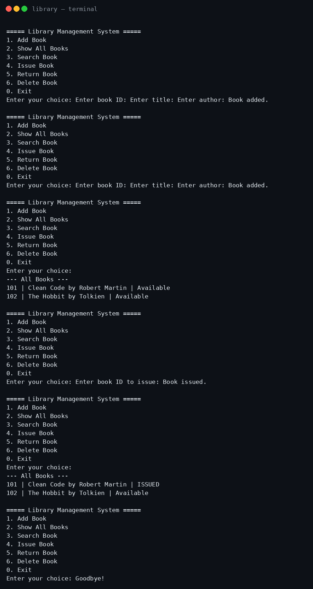

# Library Management System

A console-based library management program written in C++. It keeps records of books in a file, so the data is still there when you run the program again.

> Semester project for **Programming Fundamentals (Fall 2023)** — rebuilt and documented for this portfolio.

## Features

- Add a new book (with duplicate-ID check)
- Display all books with their status
- Search a book by ID
- Issue a book and return a book
- Delete a book
- All records saved to `books.txt` automatically



The program is built on the basics from the PF course: structs for book records, arrays to hold them, functions for each menu option, and file handling with `fstream` so the records survive between runs.

## Running it

Compile with any C++ compiler, then run:

```bash
g++ -std=c++17 -o library main.cpp
./library
```

On Windows (MinGW / Dev-C++ / Code::Blocks), compile `main.cpp` and run the generated `.exe`. The program creates `books.txt` in the same folder on first use.

## Sample menu

```
===== Library Management System =====
1. Add Book
2. Show All Books
3. Search Book
4. Issue Book
5. Return Book
6. Delete Book
0. Exit
```
